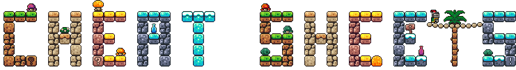

<h1></h1>
 

-   :material-train-car-container:{ .lg .middle } __[Apptainer](./apptainer/)__

    ---

    

-   :material-git:{ .lg .middle } __[Git](./git/)__

    ---

    

-   :material-penguin:{ .lg .middle } __[Linux](./linux/)__

    ---

    

-   :material-server-network:{ .lg .middle } __[MPI](./mpi/)__

    ---

-   :material-snake:{ .lg .middle } __[Python](./python/)__

    ---

    Snippets of commonly used code in my system scripts.

-   :material-bottle-soda:{ .lg .middle } [__Slurm__](./slurm/)

    ---

    Notes on things I am constantly forgetting or needing to look up in the SchedMD docs. 

-  [__Zensical__](./zensical/)

    ---

    Notes on all things Zensical

