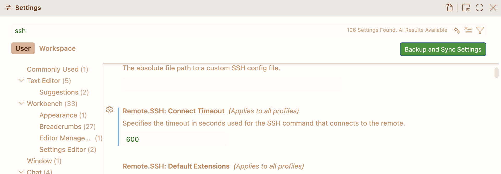

# VS Code

## Connecting to Compute

!!! warning "I don't trust this"
    As a quick note, I worked on this several months ago and then forgot about it. I'm pulling all the files I can find from random Slack chats and my SSH config (which has changed since then). I haven't done a proper test of this recently, so I'll need to come back and do that at some point.

    I feel like the mess described above is a good example of why I created this site in the first place.

Below is a (possibly, see the admonition above) working, yet ill-advised attempt at starting a Slurm job on an HPC cluster using VS Code installed on a local workstation. In this case, the system has a bastion host that serves as a intermediate gateway before the user is able to connect to a login node. 

The attempt was inspired by [https://www.psc.edu/resources/bridges-2/user-guide/#vscode](https://www.psc.edu/resources/bridges-2/user-guide/#vscode). However, since we don't have `nc` on the login nodes, things a bit... complicated.

```title="local ~/.ssh/config"
Host jump-host
  HostName <bastion host address>

Host login-host
  Hostname <login host address>
  ProxyJump jump-host
  User <username>
  ControlMaster auto
  ControlPath ~/.ssh/master-%r@%h:%p
  ControlPersist 4h

Host vscode-hpc
  ForwardAgent yes
  StrictHostKeyChecking no
  UserKnownHostsFile /dev/null
  User <username>
  ProxyCommand ssh login-host "~/bin/vscode-connect.sh %h %p"
```

And the file being called to launch the Slurm job:

```bash title="~/bin/vscode-connect.sh on HPC login node"
#!/bin/bash

hex_str="$(openssl rand -hex 16)"
hex_dir="$HOME/.cache/vscode-job/${hex_str}"
mkdir -p "${hex_dir}"

jobid=$(
    sbatch --parsable \
        --job-name=vscode-interact \
        --output="${hex_dir}/slurm.out" \
        --time=04:00:00 \
        --partition=<partition> \
        --account=<account> \
        --signal=B:USR1@30 \
<<'EOF'
#!/bin/bash
cleanup() {
    echo "Cleaning up..."
    for i in $(pgrep -u $USER -f code-server) ; do kill -9 $i ; echo "killed process $i" ; done
}

trap cleanup TERM USR1 INT
sleep 4h &
wait $!
EOF
)

if [[ -z "$jobid" ]]; then
    echo "Failed to submit Slurm job." >&2
    exit 1
fi

cleanup() {
    [[ -n "$jobid" ]] && scancel "$jobid" >/dev/null 2>&1
}

trap cleanup EXIT


# Wait until Slurm has started it
for i in {1..60}; do
    node=$(squeue -h -j "$jobid" -o "%N")

    # node names are assigned once the job is RUNNING
    if [[ -n "$node" && "$node" != "(null)" ]]; then
        echo "Job running on $node" >> "${hex_dir}/vscode.log"
        ssh "$node" -W "$node:22"
        exit $?
    fi
    echo "Job not allocated yet at $(date)" >> "${hex_dir}/vscode.log"
    sleep 10
done

echo "Timed out waiting for allocation." >&2
exit 1
```

Note that some of the script above is dedicated to cleaning up processes on the node in the event of an `scancel`, the job timing out, or some other unforseen issue. 

To note, for this to all work, it's also necessary to extend the SSH timeout in VS Code itself. This prevents VS Code from terminating the connection if the queue time on the cluster exceeds the default timeout (i.e., if the launched job spends more time pending than VS Code has the patience for). To do this, go to **Code** --> **Preferences** --> **Settings**, then search for **SSH** and edit **Remote.SSH: Connect Timeout**.

