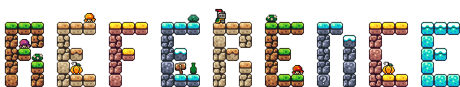

<h1></h1>
 

-   :material-link-variant:{ .lg .middle } __[Software Links](./useful_links/)__

    ---

    A collection of useful external links.

-   :material-link-variant:{ .lg .middle } __[HPC Center Docs](./hpc_centers/)__

    ---

    Links to other institutions' HPC documentation, based on topic. 

